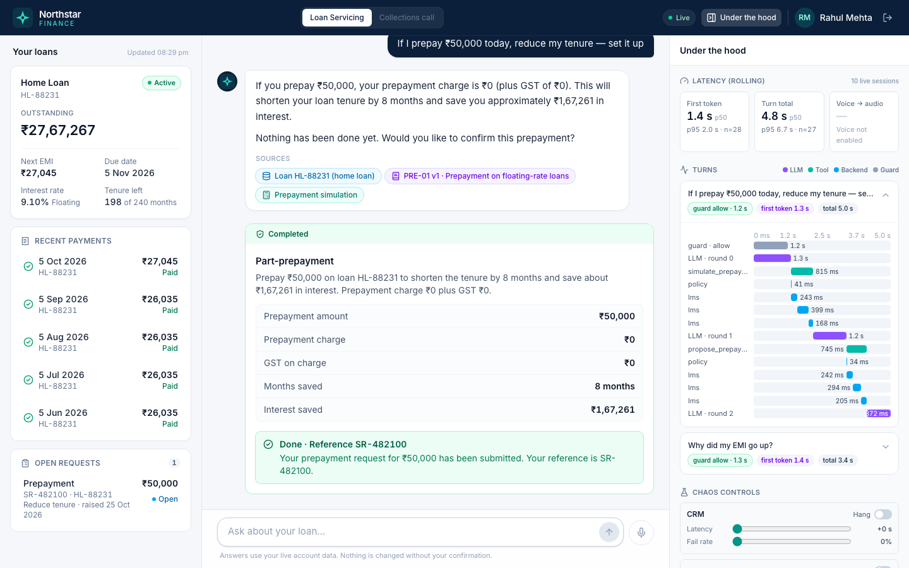
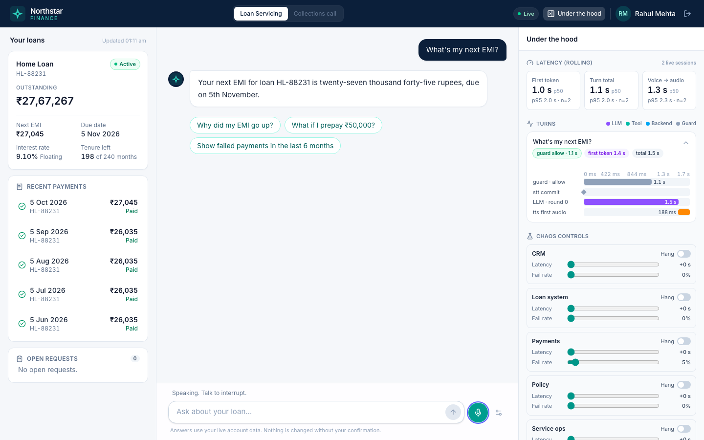

# AI Loan Servicing PoC

A voice and text assistant for a lender's loan customers ("Northstar Finance"). It answers from five mock enterprise systems (CRM, loans, payments, policy, service operations) with figures computed by code, never by the model. It takes actions (prepayment, dispute, statement, ticket, promise to pay, payment link) only after the customer confirms. A second workflow, a collections call, runs on the same platform.

- **Architecture, decisions, trade-offs:** [docs/ARCHITECTURE.md](docs/ARCHITECTURE.md). It opens with "how to evaluate this in 10 minutes".
- **Evidence:** [docs/eval-report.md](docs/eval-report.md) (accuracy and red team) and [docs/latency-report.md](docs/latency-report.md) (latency, chaos, load, replay).
- **Decision log:** [DECISIONS.md](DECISIONS.md).

| Text: prepayment proposed, confirmed and executed, with sources and the turn trace | Voice: a spoken answer, with STT, LLM and TTS in the trace |
|---|---|
|  |  |

## Prerequisites

- Node.js **22 or newer** and npm.
- A **Gemini API key** (Google AI Studio). Without one, set `LLM_PROVIDER=stub` to run on a scripted stub. The UI and tests work; the answers are canned.
- For voice: an **ElevenLabs API key** and a **voice id**. Voice is disabled without them; text still works.
- Chrome or Edge for voice (AudioWorklet, echo cancellation). Headphones are recommended.

## Setup

```bash
npm install
cp .env.example .env
```

Edit `.env`. Only the first block is needed. Everything else has working defaults.

| Variable | Value |
|---|---|
| `GEMINI_API_KEY` | your key (required when `LLM_PROVIDER=gemini`) |
| `LLM_PROVIDER` | `gemini` (default) or `stub` |
| `GEMINI_MODEL`, `GEMINI_GUARD_MODEL` | default `gemini-3.5-flash-lite` (chosen by measurement, see D-044) |
| `ELEVENLABS_API_KEY` | your key (voice) |
| `ELEVENLABS_VOICE_ID` | any voice id from your ElevenLabs Voice Library (ElevenLabs → Voices → a voice → "ID"). A clear, neutral English or Indian-English voice works best |
| `SESSION_SECRET` | any long random string (`openssl rand -hex 32`). If unset, one is generated per start and sessions do not survive a restart |
| `DEMO_ACCESS_CODE` | empty locally. When set, login asks for it, and changing chaos needs a signed-in session |
| `DEMO_TODAY` | `2026-10-25`. The synthetic data is built around this date |

## Run

```bash
npm run dev
```

This starts three processes:

- the mock systems on `127.0.0.1:4100`;
- the server on `:4000` (REST and WebSocket);
- the web app on http://localhost:5173 (Vite proxies `/api` and `/ws`).

## Demo logins and stories

Pick a customer on the login screen. The OTP is always **`123456`**.

Each login starts that customer fresh: their open requests in the mock systems (including a promise to pay), payment links and idempotency entries are cleared, and their cached backend data is dropped, so every journey can be re-run by the next reviewer. **Reset all** in the chaos panel resets everything, including chaos.

| Customer | Story | Try |
|---|---|---|
| **Rahul Mehta** (C1001) | Floating home loan. A repo-linked reset took the rate from 8.50% to 9.10%, so the EMI rose. Prepayment is free. | "Why did my EMI go up?" → "Can I keep the old EMI instead?" → "What if I prepay ₹50,000 today?" → "Do the reduce-tenure one" → **Confirm** |
| **Priya Sharma** (C1002) | Fixed personal loan with two failed debits. One bounce charge is valid; the other was levied on a bank-side technical failure and is refundable. A 4% foreclosure charge applies. | "Show my failed payments in the last six months and explain" → "Raise a dispute for the wrong one" → **Confirm**; "Am I eligible for foreclosure without a penalty?" |
| **Arjun Verma** (C1003) | Personal loan, two instalments overdue (40 days past due). | Switch the header to **Collections call**. The agent opens the call. Try "What do I owe today?", "Can I pay on the 30th?", "Send me a payment link" |
| **Neha Kapoor** (C1004) | Two loans (personal and two-wheeler). | "What's my EMI?" (it asks which loan), then "the personal loan"; "What if I prepay 20k on the two-wheeler loan?" |

Voice, in the brief's own example: press the mic and ask "What's my next EMI?". While it answers, interrupt with "Actually, check my last payment first", then ask "Okay, would paying ₹20,000 extra reduce my tenure?". Spoken actions are read back, and "yes" confirms only after the read-back has played.

**Under the hood** (the right pane) shows each turn's waterfall: guard, LLM rounds, tools and backend calls. It also shows rolling p50/p95 and the **chaos controls**. Set a system slow or failing and watch the assistant degrade honestly.

## Tests, evaluation and benchmarks

| Command | What it does | Needs |
|---|---|---|
| `npm test` | 506 unit and integration tests (vitest) across all workspaces | nothing (the Gemini smoke test skips without a key) |
| `npx tsc -b` | Type-check everything | nothing |
| `npm run eval` | 28 golden accuracy cases and 15+2 red-team cases. Regenerates `docs/eval-report.md` | a running stack started with `TEST_HOOKS=1` (for the stale-data case), a Gemini key |
| `npm run bench -- --runs 10 [--chaos payments:2500:0.3]` | Latency of the four journeys from the per-turn traces. Regenerates `docs/latency-report.md` | a running stack, a Gemini key |
| `npm run bench -- --voice-runs 5` | Voice stage timings with real STT and TTS (`scripts/voice-smoke.ts`) | Gemini and ElevenLabs keys |
| `npm run load -- --sessions 200 --turns 5` | Concurrency and server overhead with a stub LLM (starts its own stack on 4110/4010) | nothing |
| `npm run replay -- <sessionId> [--turn n] [--live-llm]` | Deterministic replay of a recorded session from `.data/events/` | a session id (from the event log file names) |

For example, to run the eval against a stack with test hooks:

```bash
TEST_HOOKS=1 npm run dev
npm run eval
```

## Demoing over a video call

- **Use headphones.** Open-mic barge-in listens for speech energy. Laptop speakers feeding back into the mic can make the assistant interrupt itself. Browser echo cancellation and a self-echo guard help, but they have not been tested on open speakers.
- **Share the browser tab, not the screen,** and tick **"Share tab audio"** in Chrome's share dialog, so the call hears the assistant.
- **Push-to-talk is the fallback.** Use the settings icon next to the mic, then hold the mic button or **Space** while speaking. Use it if the room is noisy or a reviewer's voice keeps triggering barge-in.
- **Warm up once before the call.** Log in, ask one text question and one voice question. This warms the model, the STT and TTS sockets, and the caches, so the first live turn is not a cold start.
- Do not leave chaos on between demos. Use **Reset all** in the chaos panel.

## Troubleshooting

| Symptom | Fix |
|---|---|
| Answers say a system is unavailable after a chaos demo | The circuit breaker stays open for about 10 s after failures, and cached data may be stale. Click **Reset all**, or `curl -X POST localhost:4000/api/chaos/reset` (this also restores the mock data). With `DEMO_ACCESS_CODE` set, add `-H "authorization: Bearer <token>"` |
| "Voice is busy right now" (`voice_capacity`) | At most `MAX_VOICE_SESSIONS` (default 5) voice sessions at once, because each holds two vendor sockets. Stop voice in another tab, or raise the limit |
| Voice switched itself off | Voice stops after `VOICE_IDLE_MS` (default 2 min) without speech or an answer, after `VOICE_MAX_MS` (default 15 min) in total, when the tab is hidden, or when the same customer starts voice in another window (one voice session per customer). Press the mic again |
| Voice does not start, and the server logged "voice mode is disabled" at startup | Set both `ELEVENLABS_API_KEY` and `ELEVENLABS_VOICE_ID`, then restart |
| Server exits with `GEMINI_API_KEY is required` | Add the key, or set `LLM_PROVIDER=stub` |
| "Very high demand" replies under load | The LLM limiter (`LLM_MAX_CONCURRENCY`, queue `LLM_QUEUE_TIMEOUT_MS`) is shedding load by design |
| Reconnects after sleep or network loss | Expected. Within 5 minutes the same session and history resume |

## Docker

```bash
docker build -t loan-poc .
docker run --rm -p 4000:4000 --env-file .env loan-poc
curl localhost:4000/api/health
```

The image runs the server and the mock systems: `scripts/start.sh` supervises both and exits if either exits. It runs as a non-root user with `NODE_ENV=production` and has a health check. The web app is a static build (`VITE_API_BASE=<api origin> npm run build -w @app/web`) served separately.

## Deployment (GitHub Actions)

- `.github/workflows/ci.yml` runs on every push and pull request: type-check, tests, and a gitleaks scan of the full history. It needs no secrets.
- `.github/workflows/deploy.yml` runs only on a push to `main` (or a manual run on `main`) of `RiskyAV/agentic-ivr`, after CI passes.
  - The `api` job uploads a `git archive` release over SSH as a locked-down deploy user and activates it with a root-owned script. The script installs the dependencies, swaps the release, restarts, health-checks and rolls back on failure. The job then checks that `https://api.sparsan.com/api/health` returns `"ok":true`.
  - The `web` job builds the app and deploys it to Cloudflare Pages.
- `scripts/deploy.sh bootstrap|api|web|all [--dry-run]` holds the deploy steps for both CI and local use. `bootstrap` is the owner's one-time VM setup.
- The one-time setup (repository hardening, deploy key, VM bootstrap, Cloudflare, DNS) is in [deploy/SETUP.md](deploy/SETUP.md).

## Security and secrets

- **App secrets** (Gemini and ElevenLabs keys, session secret, demo access code) live **only on the VM**, in `/opt/loan-poc/.env` (mode 640). They are copied once by hand. No workflow writes them, and the browser never sees them.
- **CI** holds no cloud credentials, only the following, all as secrets of the `production` environment, which runs on `main` only:
  - an SSH deploy key, with its host key pinned;
  - a Cloudflare token scoped to Pages edit.

  On the VM, the deploy key is a forced command. It can only upload a release tarball to `/opt/loan-poc/incoming/` and run the one activation script that `sudo` allows. It has no shell, no forwarding, and no access to nginx, systemd or the other site on the VM. The worst case for a leaked key is deploying application code that runs as the unprivileged app user ([deploy/SETUP.md §3](deploy/SETUP.md#3-deploy-key-and-vm-bootstrap)).
- **The repository** is public, but only the owner can push (configured as in [deploy/SETUP.md](deploy/SETUP.md) §2). A ruleset protects `main`, fork PR workflows need approval, the default token is read-only and the actions are allow-listed. CI scans the full history with gitleaks on every push. `.env`, `.data/` and `.superpowers/` are git-ignored.
- **In the app:**
  - data access is scoped server-side to the signed-in customer;
  - the model can only propose actions; execution needs the customer's confirmation, bound to the exact terms;
  - PII is masked before it reaches prompts or logs;
  - a guard screens malicious input;
  - `TEST_HOOKS` is refused in production.

  See [ARCHITECTURE.md §9](docs/ARCHITECTURE.md#9-security).

## Repository map

```
apps/web/             React app: chat, account panel, action cards, trace panel, chaos controls, voice capture/playback
apps/server/          Agent server
  src/gateway/          auth (HMAC tokens), REST, WebSocket, rate limits
  src/platform/         workflow-agnostic platform: engine, llm, tools, grounding, actions, connectors,
                        guard, voice, context, telemetry, workflows registry
  src/workflows/        workflow packs: loan-servicing, collections, shared helpers
apps/mock-systems/    Mock CRM, LMS, payments, policy and service-ops APIs with latency, failures and chaos
packages/domain/      Pure finance (EMI, amortisation, prepayment, foreclosure, penal), versioned policy clauses,
                      INR formatting and amount parsing
packages/shared/      Wire protocol and view types shared by server and web
scripts/              eval (golden + red team), bench, load, replay, voice smoke, start.sh, deploy.sh
deploy/               nginx site, systemd units, SETUP.md
docs/                 ARCHITECTURE.md, eval and latency reports, design spec
```
