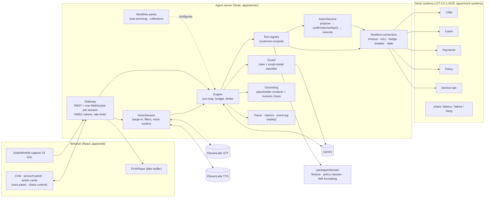
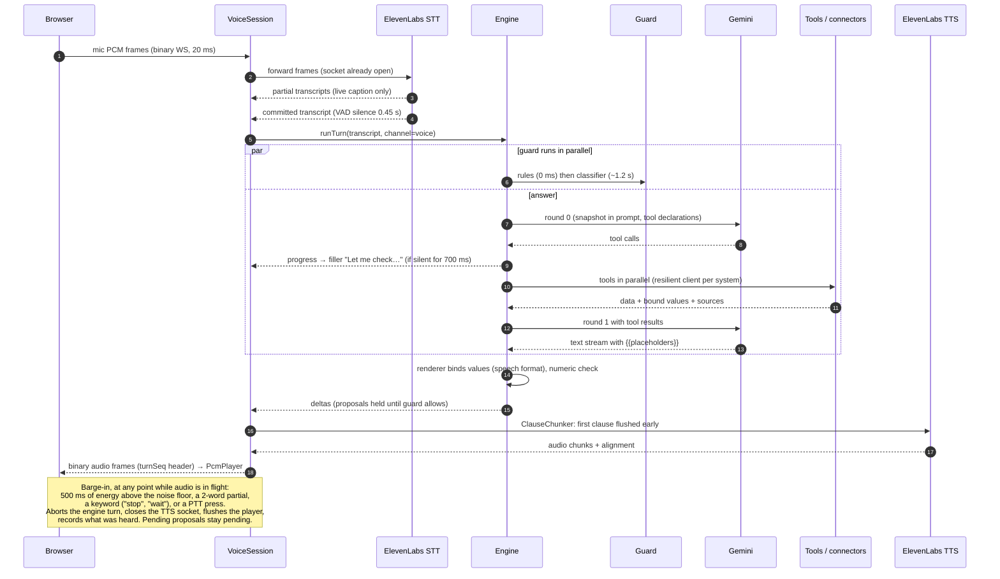

# Architecture, decisions and trade-offs

**Summary.**
- This is a voice and text assistant for a lender's loan customers. It answers from five mock enterprise systems (CRM, loans, payments, policy, service operations) and takes actions only after the customer confirms them.
- **Accuracy comes from the architecture, not the prompt.** Every figure in an answer is computed by code and bound into the text through a placeholder. Policy is versioned structured rules. The LLM cannot execute anything.
- Voice and text run through one engine over one WebSocket. Voice is our own streaming STT → engine → TTS pipeline, with barge-in.
- A second workflow (a collections call) runs on the same platform with **zero lines changed under `apps/server/src/platform`**.
- **Measured results** (Gemini `gemini-3.5-flash-lite`): 28/28 golden cases on 3 of 3 runs, 15/15 red-team cases, text turn p50 3.9 s / p95 6.7 s. Voice reaches first audio 3.3 s (p50) after the user stops speaking, against a 1 s goal; that miss is discussed in [Latency](#7-latency).

**How to evaluate this in 10 minutes**

1. `npm install && cp .env.example .env` (add the keys), then `npm run dev`, then open http://localhost:5173. Or open the hosted app.
2. Log in as **Rahul Mehta** (OTP `123456`). Each login starts that customer fresh (their mock requests, payment links and cached data are reset), so every journey can be re-run; **Reset all** is also available. Ask *"Why did my EMI go up?"*, then *"What if I prepay ₹50,000 today?"*, then *"Do the reduce-tenure one."* Click a source chip, then **Confirm** on the card. Watch the account panel's *Open requests* update.
3. Open **Under the hood** (trace panel). Each turn shows a waterfall of guard, LLM rounds, tools and backend calls.
4. In **Chaos controls**, set Payments to fail at 100%. Log in as **Priya Sharma** and ask *"Show my failed payments"*. There are two honest outcomes, never an invented answer: "I can't check that right now", or, if her payments were fetched earlier in the same session, that earlier data clearly labelled as not live with its age. Reset with **Reset all** (or `POST /api/chaos/reset`).
5. Switch the header to **Collections call** as **Arjun Verma**. The agent opens the call, states the overdue amount, and records a promise to pay.
6. Press the mic. Ask *"What's my next EMI?"*, interrupt it with *"actually, check my last payment first"*, then ask *"would paying ₹20,000 extra reduce my tenure?"*
7. `npm test` (506 tests, no keys needed). With keys and a running stack, `npm run eval` regenerates [eval-report.md](eval-report.md).

---

## 1. Problem and approach

The lender's complaints are generic or wrong answers, slow menu-driven voice support, requests that span several systems, and every new use case being a new hardcoded bot. The brief asks for five things:

1. a customer-facing app (text and voice, at least three journeys);
2. an accurate query engine over account data, policy, calculations, history and several backends;
3. real-time voice with interruptions and intent changes;
4. integrations with slow, failing systems, plus real actions;
5. one reusable platform capability, proven by a second workflow.

It explicitly warns against "an LLM connected to a vector database".

The approach treats the LLM as a **planner and writer**, not a source of truth:

- deterministic code fetches the data, does the arithmetic, evaluates the policy and executes actions;
- the model chooses tools and writes prose around placeholders;
- the platform (engine, connectors, grounding, actions, guard, voice, telemetry) is workflow-agnostic;
- a workflow is a typed pack: prompt, tools, actions, policy topics, opener, fillers.

## 2. Components

| Layer | Code |
|---|---|
| Gateway (auth, REST, WebSocket, rate limits) | `apps/server/src/gateway/` |
| Engine and prompt layout | `apps/server/src/platform/engine/engine.ts`, `prompts.ts` |
| Grounding | `apps/server/src/platform/grounding/renderer.ts`, `numericCheck.ts`, `values.ts` |
| Actions | `apps/server/src/platform/actions/actionService.ts`, `audit.ts` |
| Connectors | `apps/server/src/platform/connectors/resilientClient.ts`, `clients.ts` |
| Guard | `apps/server/src/platform/guard/rules.ts`, `classifier.ts`, `guard.ts` |
| Voice | `apps/server/src/platform/voice/turnManager.ts`, `stt.ts`, `tts.ts`, `affirm.ts` |
| Telemetry and replay | `apps/server/src/platform/telemetry/`, `scripts/replay.ts` |
| Workflows | `apps/server/src/workflows/{loan-servicing,collections,shared}/` |
| Domain (pure) | `packages/domain/src/{finance,policy,format}/` |
| Web | `apps/web/src/` (`store.ts` reducer, `socket.ts`, `voice/`, `components/`) |

## 3. One voice turn

The engine starts **only on the committed transcript**. Speculative starts on partial transcripts were rejected (D-014): partials are exactly where "fifty" becomes "fifteen" thousand, and the saving is about 100–300 ms. Text turns follow the same path from `runTurn` onward, with display formatting instead of speech formatting.

## 4. Challenge-by-challenge

| Challenge | What was built | Code | Evidence |
|---|---|---|---|
| **1. Customer experience** | A three-pane app (account panel, chat, "under the hood"). It has four journeys: EMI change, prepayment with a confirmed request, failed payments with a confirmed dispute, and a collections call. It also covers a two-loan customer. Source chips, inline tables, action cards. Context carries across turns ("and 20,000 instead?"). | `apps/web/src/`, `apps/server/src/platform/context/` (snapshot, entities) | Eval G05, G06, G10, G13, G19, G23/24; screenshots in the README |
| **2. Accurate query engine** | Combined tools for frequent questions, basic tools for the long tail. Domain calculators. Versioned policy rules. Placeholder-bound figures. A numeric check. | `workflows/loan-servicing/tools.ts`, `packages/domain/src/`, `platform/grounding/` | 28/28 golden on 3 of 3 runs, including all five example questions (G01–G04, G12) |
| **3. Real-time voice** | Streaming STT → engine → clause-chunked TTS. Barge-in on energy, words or keywords. Fillers while tools run. An echo guard. Deterministic spoken confirmation. A push-to-talk fallback. | `platform/voice/`, `apps/web/src/voice/` | [latency-report.md § Voice](latency-report.md#voice): first audio p50 3336 ms at the client, barge-in 1258 ms |
| **4. Integrations and actions** | Five mock systems with their own latency and failure profiles plus runtime chaos. Resilient connectors. Six actions: prepayment, dispute, statement, ticket, promise to pay, payment link. Each one is proposed, confirmed against a terms hash, revalidated at execution, idempotent and audited. | `apps/mock-systems/`, `platform/connectors/`, `platform/actions/` | Chaos run: 0 of 70 turns degraded with payments failing 30% and +2.5 s |
| **5. Reusable platform** | Workflow packs on a shared engine, tools, connectors, grounding, actions, guard, voice and telemetry. The collections pack was added as a definition, a prompt, one tool and two actions. | `platform/workflows/types.ts`, `workflows/collections/` | `git diff 5a8d57a b3101dd -- apps/server/src/platform` is empty; see [§10](#10-platform-extensibility) |

## 5. Key decisions

The full log, with dates and trade-offs, is [`DECISIONS.md`](../DECISIONS.md) (D-001 to D-052). The most consequential decisions:

| Decision | Chosen | Rejected, and why |
|---|---|---|
| Voice architecture (D-003) | Own STT → engine → TTS pipeline | Native speech-to-speech: a separate, unverifiable path for figures and actions |
| LLM start (D-014) | On the committed transcript | Speculative start on partials: saves about 100–300 ms, but risks answering the wrong amount and causes abort churn |
| Figures (D-015) | Placeholders bound by code | The LLM writes numbers and they are checked after: detection without prevention |
| Tool granularity (D-016) | Combined tools plus basic tools | Only basic tools (slow, chains go wrong) or only combined tools (brittle) |
| Policy (D-017) | Versioned structured rules | Vector search over policy documents: no version awareness, plausible but inapplicable text |
| Actions (D-021) | Hash-bound confirmation, no execute tool | Executing when the model decides the user agreed |
| Malicious input (D-026) | Capability limits in code, plus a parallel guard | Prompt-only guardrails; a serial guard (+200–400 ms on every turn) |
| Resilience (D-019) | Hedge, breaker, disclosed stale data | Retries alone, which add latency exactly when it hurts |
| Workflow format (D-025) | Typed TypeScript packs | YAML/JSON config: worth it once non-engineers author workflows |
| Model (D-044) | `gemini-3.5-flash-lite` | `gemini-3.8-flash`: 25/28 and p95 9005 ms with 9/35 degraded turns. `2.5-flash`: 24/28. Measured, see the latency report's model table |
| Scale path (D-005, D-024) | In-memory behind interfaces; limiter and backpressure now | Building Redis or a database into the PoC: no demo value, and it slows live changes |

## 6. Accuracy: not "an LLM plus a vector DB"

The weak point of a typical RAG bot is that the model writes the numbers and picks the policy text. Five mechanisms here remove both jobs from the model:

1. **Figures are bound by code (D-015, D-039, D-047).** A tool returns named `values`, for example `prepay.interest_saved`. The model writes `you save {{prepay.interest_saved}}`. The streaming renderer substitutes the code-formatted value: `₹1,67,261` on screen, "one lakh sixty-seven thousand…" in speech (D-020). An unresolved placeholder fails closed and is flagged in the trace. Bound values are semantic, so there is nothing to misread: `refundable`, `disputable` and `penalty_free` instead of raw flags.
2. **Combined tools (D-016).** `explain_emi_change`, `simulate_prepayment`, `check_foreclosure`, `list_options` and `get_overdue_summary` each fetch and compute in one call. A common question needs one tool round, not a chain the model can get wrong.
3. **Versioned policy rules, not retrieved text (D-017, D-031).** Clauses are data: id, version, effective dates, applicability, numeric parameters and an evaluator. The version is selected by the loan's sanction date or the event date. Cited text and computed charges come from the same record (`packages/domain/src/policy/`).
4. **Numeric check (D-039).** Any literal number the model writes anyway is compared with the turn's bound values. A mismatch is flagged in the trace (metric `unverified`) and fails the eval; the text itself is not changed. Only an unresolved placeholder renders as `[unverified]` in the answer.
5. **Evaluation (D-051).** 28 golden cases compute their expected figures at run time from the same domain code, and the scoring is strict. It checks Yes/No leads, word boundaries, invented rupee amounts, unresolved placeholders and numeric flags. See [eval-report.md](eval-report.md).

**Result** (strict scorer, `gemini-3.5-flash-lite`): golden **28/28, 28/28, 28/28**; red team **15/15** on every run, plus 2/2 crafted-confirm extras. The same prompts on `gemini-2.5-flash` scored 24/28, and on `gemini-3.8-flash` 25/28. The prompts were tuned on flash-lite, so this comparison favours it.

## 7. Latency

Headline numbers, from [latency-report.md](latency-report.md) (`npm run bench -- --runs 10`, 70 traced turns, default mock latencies):

| Metric | p50 | p95 |
|---|---|---|
| LLM first token (round 1) | 1348 ms | 1755 ms |
| Text turn, server `turn_total` | 3947 ms | 6730 ms |
| Turn under chaos (`payments:2500:0.3`) | 3615 ms | 5687 ms |
| Guard verdict (parallel, off the critical path) | 1163 ms | 1408 ms |
| Voice: end of speech → final transcript | 1041 ms | 1122 ms |
| Voice: end of speech → first audio at the client | 3336 ms | 3838 ms |
| Voice: barge-in (interruption → `barge_in`) | 1258 ms | 1278 ms |

**Where the time goes.** In the median turn, LLM rounds account for 71% of the server time and tools for 29%. A tool turn needs two model rounds, and each round costs about 1.3 s before its first token. The slowest tools are `propose_promise_to_pay` and `get_payment_history`, because they fan out to payments and ops, whose backend p50 is 627 ms and 763 ms. In voice:

- the STT commit costs about 1.0 s (VAD silence plus vendor finalisation);
- the LLM costs about 2.0 s to its first token;
- the first TTS audio follows about 0.2 s after the first clause.

Voice misses the spec's "under 1 s for no-tool turns" goal by about 2 s. That is the biggest gap in this PoC.

**Next, in order of expected gain:**

1. **Endpointing on streaming partials.** Commit on a semantic end of turn, from a stable partial plus a short silence, instead of waiting for the vendor's VAD commit. Expected gain about 0.5–0.8 s.
2. **A smaller, cached prompt prefix.** Trim the tool declarations and policy summaries per workflow, and use explicit context caching (D-018). Expected gain about 0.3–0.5 s on first token.
3. **Regional model and voice endpoints.** Measure them close to the users; the bench used the vendors' default endpoints.
4. **Answer from the snapshot without a tool round** for more question types. The snapshot is prefetched at session start.
5. **Cached TTS for fixed phrases** (fillers, "Shall I go ahead?", confirmations), and a pre-rendered opener.
6. Speculative LLM start stays rejected unless measurements show STT finalisation dominating after (1).

## 8. Reliability

- **Resilient client, one per system (D-019, D-035).** Each call gets:
  - a timeout per attempt (1.5 s);
  - retries with backoff, for idempotent requests only;
  - a hedged second request after the rolling p95, within a 10% budget;
  - a circuit breaker (opens after 5 failures, 10 s, one half-open trial);
  - stale-while-revalidate: the last good value is served with a bound `stale.as_of` ("5 minutes ago (at 01:15 UTC)"), and the answer must say it is not live (eval G27).

  Writes carry idempotency keys and are never hedged.
- **A turn budget (9 s) that always ends the turn.** A backend slower than the budget yields an honest partial answer, not a hang. One active turn per session. A process-wide LLM limiter (50) with a 4 s queue timeout sheds load with a "high demand" message (D-024).
- **Chaos results.** Payments was set to fail 30% of calls and to add 2.5 s to the rest. Over 70 turns: p95 5687 ms, max 6135 ms, 0 turns degraded. The breaker short-circuited 21 payments calls. The journeys that need payments honestly did not reach their proposal: J3 reached it in 6 of 10 runs and J4 in 0 of 10.
- **Honest finding on hedging.** Hedging fired 1 time in 318 calls. Under a uniform slowdown the rolling p95 moves too, and under failures the breaker opens first. Hedging helps occasional outliers, which these profiles did not produce.
- **Resume.** A reconnect within 5 minutes resumes the same session and history. A double confirm returns the original reference and does not execute twice (D-040, D-045).
- **Replay (D-023).** Every turn is event-logged: backend responses, LLM output and guard verdicts. `npm run replay -- <sessionId>` reproduces a recorded session exactly (3 of 3 turns identical), or re-runs it with the live model against the recorded backends.

## 9. Security

| Control | How |
|---|---|
| Data scoping (D-009) | No tool schema has a customer id. The customer comes from the HMAC-signed session token. Loan ownership is checked server-side. |
| Actions (D-021, D-040) | The model only has `propose_*` tools. Execution happens only through `ActionService.confirm(proposalId, termsHash)`: the app's button, or a deterministic spoken "yes". Terms are revalidated at execution. Actions are idempotent and audited. |
| Voice consent | Spoken consent is armed only after the read-back of exactly one pending proposal has **played** to the end without barge-in. A "yes" that started earlier gets a re-read. An echo guard drops the assistant's own words. The affirmation set is fixed ("yes", "go ahead", "haan ji"), with no LLM in the loop. Barge-in never touches a proposal (D-048). |
| Data minimisation (D-022) | PAN, phone, email and account numbers are masked (`XXXXXX1234`) before prompts, logs and traces. |
| Malicious input (D-026, D-043) | Rule check plus a classifier, running in parallel with the turn. Proposals are held until the guard allows. A blocked turn is retracted and refused, with escalation from the second strike. Backend free text is wrapped as untrusted. |
| Red team | 15/15 on every run: injection, impersonation, cross-customer access, fee-waiver coercion, prompt extraction, malicious dispute text and abuse. 2/2 crafted "confirm proposal PRP-…" messages executed nothing. |
| Hosted demo (D-052) | `DEMO_ACCESS_CODE` gates login and chaos changes. `TEST_HOOKS` is refused in production. The API binds to loopback behind nginx. Secrets live only on the server; the browser never talks to Gemini or ElevenLabs. The CI deploy holds no cloud credentials: an SSH key restricted to a forced command can only upload a release and run one root-owned activation script (verify, install as the app user, swap, health-check, roll back). See `deploy/SETUP.md`. |

Limits: there is no real authentication (picker plus a fixed OTP), and the guard is fail-open. A classifier timeout lets the text through, but drops any proposals from that turn.

## 10. Platform extensibility

A workflow is a `WorkflowDefinition` (`platform/workflows/types.ts`) made of a system prompt, tool names, action types, policy topics, an optional opener and voice fillers (D-025). Everything else is shared: the engine, prompt layout, grounding, actions with confirmation and audit, connectors, guard, voice, the trace panel, eval and replay.

**Collections as the proof** (commits `690b1f9` and `b3101dd`):

| | Files | Lines |
|---|---|---|
| `workflows/collections/` (definition, prompt, `get_overdue_summary`, `promise_to_pay` and `payment_link` actions, a penal-charge helper) | 5 | 254 |
| its tests | 1 | 153 |
| `workflows/shared/requests.ts` (request helpers moved out of loan-servicing) | 1 | 34 (moved, not new) |
| Registration in `app.ts` | 1 | +6 / −2 |
| **`apps/server/src/platform/`** | **0** | **0** |

The UI needed one change: payment links became clickable. The workflow switcher, action cards, trace and voice worked unchanged. Collections also gets voice, chaos tolerance, the guard and eval coverage (G17–G22) for free.

**A third workflow (credit cards) would need:**

1. a card connector (statement, unbilled, limit) in `connectors/clients.ts`, plus mock routes;
2. domain calculators (minimum due, interest on revolving balance) and card policy clauses;
3. a pack with 2–3 combined tools (`explain_statement`, `simulate_payment`) and actions such as `block_card` or `convert_to_emi`;
4. golden cases.

No engine, grounding, action, guard or voice changes. The cost scales with the domain logic, not the plumbing. Later, when non-engineers author workflows, the typed pack can be serialised to config.

## 11. Production path and known limitations

**Production path (not built).**

- **State:** Redis or Memorystore for sessions, proposals, breaker state and caches. Sticky WebSocket routing by session id, and N stateless Node processes on Cloud Run or GKE.
- **Capacity:** raise the LLM limiter to the provider quota, give the guard its own pool, use a buffered asynchronous event log, and shed load by queue depth. The load test shows the scarce resource is model tokens: 500 sessions with the LLM cap lifted ran at p50 2313 ms against an ideal of 1800 ms, using 236 KB per idle session.
- **Operations:** OpenTelemetry export; eval and red team in CI as a release gate.
- **Security and integrations:**
  - real authentication (OIDC, plus step-up OTP for actions);
  - a policy store with versioning and effective dates, plus an authoring UI;
  - telephony via SIP or Twilio media streams into the same `VoiceSession`;
  - vendor fallback for STT, TTS and the LLM;
  - Hindi and Hinglish.
- **Cut-line items:** strict-mode answer regeneration when the numeric check fails (today the answer is flagged instead), and the statement action delivering a file (today it creates a service request).

**Known limitations (honest list).**

- All state is in memory in a single process. A restart loses sessions, pending proposals and the audit log. The mocks reset with the process, and each login resets that customer's mock requests and payment links (demo convenience: two reviewers using the same customer at once will clear each other's requests).
- Voice first audio (3.3 s p50) is well over the 1 s goal (see §7).
- The prompts were tuned on one model, `gemini-3.5-flash-lite`. Other models score lower until re-tuned. Eval phrase lists can miss a correct paraphrase; the widenings are disclosed in the eval report.
- Echo handling (browser echo cancellation plus the self-echo guard) has not been tested on open laptop speakers in a video call; the voice runs used synthetic fixtures and headphones. Push-to-talk is the fallback (see the README's video-call section).
- Hedging showed no measurable benefit on these failure profiles (§8).
- Chaos is global to the process: one reviewer's chaos affects everyone.
- Voice is capped at `MAX_VOICE_SESSIONS=5`, because each voice session holds two vendor sockets. To stop one reviewer locking the others out (and to bound vendor cost), a voice session ends after 2 minutes without a committed transcript or assistant audio (`VOICE_IDLE_MS`), after 15 minutes in total (`VOICE_MAX_MS`), when the tab is hidden, or when the same customer starts voice elsewhere (one per customer).
- The mock data is synthetic and the clock is fixed (`DEMO_TODAY=2026-10-25`). There is no real authentication, and the OTP is fixed.
